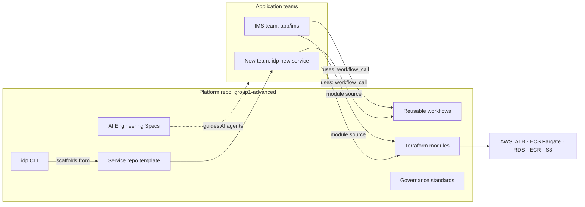

# group1-advanced — AI-Driven Cloud & DevSecOps Internal Developer Platform

<p align="left"></p>

Capstone submission for **Acme Retail Ltd.'s AI-Driven Cloud & DevSecOps Modernization Program**.

| | |
|---|---|
| **Role** | Platform Engineer |
| **Capstone level** | Advanced (`group1-advanced`) |
| **Reference application** | Inventory Management System (IMS) — Python 3.12 / Flask / PostgreSQL |
| **Cloud target** | AWS (ECS Fargate, RDS, ECR, S3, Secrets Manager) via Terraform |
| **CI/CD** | GitHub Actions reusable workflows |
| **Security** | Gitleaks · Trivy · Checkov |

> **Mission:** turn the one-off engineering built for the IMS into a reusable **Internal Developer Platform
> (IDP)**: shared Terraform modules, reusable GitHub Actions workflows, a repository template, governance
> standards and a self-service CLI. Any application team can then onboard with minimal customization.

---

## Contents

1. [The business problem](#1-the-business-problem)
2. [Solution overview](#2-solution-overview)
3. [Architecture](#3-architecture)
4. [Repository structure](#4-repository-structure)
5. [Quick start](#5-quick-start)
6. [Self-service platform CLI (`idp`)](#6-self-service-platform-cli-idp)
7. [The reference application (IMS)](#7-the-reference-application-ims)
8. [Reusable CI/CD workflows](#8-reusable-cicd-workflows)
9. [Infrastructure as Code](#9-infrastructure-as-code)
10. [Onboarding a new team](#10-onboarding-a-new-team)
11. [Security and governance](#11-security-and-governance)
12. [AI Engineering Specifications](#12-ai-engineering-specifications)
13. [Engineering decisions (ADRs)](#13-engineering-decisions-adrs)
14. [What was validated](#14-what-was-validated)
15. [Known limitations and roadmap](#15-known-limitations-and-roadmap)
16. [Presentation](#16-presentation)

---

## 1. The business problem

The IMS was ready to deploy, but Acme Retail's engineering processes were inconsistent, manual and hard to
scale. The brief lists six problems; every platform component below maps back to at least one of them.

| # | Problem | Platform answer |
|---|---|---|
| 1 | Duplicate pipelines | Three **reusable workflows** called with `workflow_call`; each app keeps a ~20-line caller |
| 2 | Duplicate Terraform | Six **versioned Terraform modules** composed per environment |
| 3 | Different repository structures | One **service repo template** with a fixed layout |
| 4 | Inconsistent AI specifications | Six **standard AI Engineering Specs** plus fill-in templates for every new service |
| 5 | Long onboarding | `idp new-service <name>` scaffolds a ready-to-run, CI-wired repo in seconds |
| 6 | High maintenance | Fix a workflow or module once in the platform; every consuming team picks it up by bumping a ref |

## 2. Solution overview

| Building block | Where | What it gives a team |
|---|---|---|
| Reusable workflows | [`.github/workflows/reusable-*.yml`](.github/workflows) | Lint → test → build → secret/dependency/image/IaC scan → Terraform validate |
| Terraform modules | [`infrastructure/modules/`](infrastructure/modules) | `networking`, `ecr`, `ecs-fargate-service`, `rds-postgres`, `s3-bucket`, `iam-app-role` |
| Environment composition | [`infrastructure/environments/dev/`](infrastructure/environments/dev) | Shows how the IMS consumes the modules |
| Repo template | [`templates/service-repo-template/`](templates/service-repo-template) | Flask skeleton, caller workflows, infra, spec stubs |
| Governance | [`.github/CODEOWNERS`](.github/CODEOWNERS), [`PULL_REQUEST_TEMPLATE.md`](.github/PULL_REQUEST_TEMPLATE.md), [`SECURITY.md`](SECURITY.md) | Ownership, review checklist, vulnerability reporting |
| Self-service CLI | [`scripts/idp.py`](scripts/idp.py) | One tool for scaffold, setup, test, run, scan and validate |
| AI Engineering Specs | [`docs/ai-specifications/`](docs/ai-specifications) | The source of truth AI coding agents generate from |
| Reference app | [`app/ims/`](app/ims) | A real product proving the platform end to end |

The engineering approach followed the brief: understand the problem → split into domains → **write the AI
Engineering Specifications** → generate with an AI coding agent → review, validate, refactor and secure →
test, document and package.

## 3. Architecture

Detailed diagrams (Mermaid, rendered by GitHub) live in [`docs/architecture/`](docs/architecture):

| Document | Covers |
|---|---|
| [platform-architecture.md](docs/architecture/platform-architecture.md) | IDP components, onboarding sequence, multi-team reuse, versioning |
| [ims-architecture.md](docs/architecture/ims-architecture.md) | IMS components, ER diagram, checkout sequence, local runtime |
| [cicd-pipeline.md](docs/architecture/cicd-pipeline.md) | Workflow flow, gates, local ↔ CI parity |
| [aws-deployment-architecture.md](docs/architecture/aws-deployment-architecture.md) | VPC, ALB, ECS, RDS, ECR, S3, IAM, security groups |
| [security-architecture.md](docs/architecture/security-architecture.md) | Shift-left security layers and controls |

High-level view:



## 4. Repository structure

```
README.md                         You are here
SECURITY.md                       Vulnerability reporting / security policy
app/ims/                          Reference app: Inventory Management System (Flask + SQLAlchemy + Postgres)
  app/                              Flask package: models, routes (/api/v1), schemas, seed, web UI, static/logo
  tests/                            pytest suite (in-memory SQLite, no external services)
  Dockerfile  docker-compose.yml    Hardened image + local Postgres stack
  openapi.yaml                      API contract
infrastructure/
  modules/                        Reusable Terraform modules (each with README, variables, outputs)
  environments/dev/               Environment composition used by the IMS
templates/service-repo-template/  Starter repo new teams get from `idp new-service`
.github/
  workflows/                      reusable-ci, reusable-security-scan, reusable-terraform + callers ci, terraform
  CODEOWNERS  PULL_REQUEST_TEMPLATE.md
scripts/
  idp.py  idp.ps1  idp            Self-service platform CLI (+ Windows / POSIX wrappers)
  *.ps1                           Backwards-compatible wrappers around idp
docs/
  ai-specifications/              The 6 required AI Engineering Specifications (primary artifact)
  architecture/                   Architecture docs with Mermaid diagrams
  engineering-decisions/          ADR-0001 … ADR-0004
presentation/                     Final deck (.pptx + .pdf)
```

## 5. Quick start

### Prerequisites

| Tool | Needed for | Required? |
|---|---|---|
| Python 3.10+ | The app, its tests and the `idp` CLI | Yes |
| Git | Version control | Yes |
| Podman **or** Docker | Container build, local stack, security scans | For containers / scans |
| Terraform ≥ 1.5 | `idp tf-validate` | For IaC validation |

Check everything at once:

```powershell
python scripts/idp.py doctor
```

### Run the tests (no containers needed)

```powershell
python scripts/idp.py bootstrap        # creates app/ims/.venv, installs deps, seeds .env
python scripts/idp.py ci --skip-containers   # ruff lint + pytest, same as CI
```

### Run the full app locally

```powershell
python scripts/idp.py up               # Postgres 16 + IMS API containers, waits for /health
# open http://localhost:3000/         -> web UI
python scripts/idp.py status
python scripts/idp.py down
```

Or with Docker Compose: `docker compose -f app/ims/docker-compose.yml up --build`.

Try the API:

```powershell
curl http://localhost:3000/health
curl http://localhost:3000/api/v1/products?search=laptop
curl -X POST http://localhost:3000/api/v1/products -H "Content-Type: application/json" -H "X-API-Key: demo-key" `
  -d '{"sku":"SKU-100","name":"Pallet Jack","quantity":5,"price":1200}'
curl -X POST http://localhost:3000/api/v1/cart -H "Content-Type: application/json" -d '{"product_id":1,"quantity":2}'
curl -X POST http://localhost:3000/api/v1/cart/checkout
```

> On Podman for Windows/macOS, start the VM first: `podman machine start`.

## 6. Self-service platform CLI (`idp`)

[`scripts/idp.py`](scripts/idp.py) uses only the Python standard library, so it needs no install. Run it as
`./scripts/idp.ps1 …` (Windows), `./scripts/idp …` (Linux/macOS) or `python scripts/idp.py …` (anywhere).

| Command | What it does | CI equivalent |
|---|---|---|
| `doctor` | Checks python, git, podman/docker, terraform are on PATH | — |
| `list-services` | Lists Python services and templates in the repo | — |
| `new-service <name> [--output DIR] [--git]` | Scaffolds a new repo from the template, replacing `TODO-service-name` | — |
| `bootstrap [--app DIR]` | Creates `.venv`, installs `requirements-dev.txt`, seeds `.env` | Install step |
| `lint` | `ruff check` | `reusable-ci.yml` → Lint |
| `test [pytest args]` | `pytest -q` | `reusable-ci.yml` → Test |
| `build [--tag T]` | Builds the container image | `reusable-ci.yml` → Build |
| `up [--port N]` / `status` / `down` | Local Postgres + API stack with health check | — |
| `scan [--skip-iac]` | Gitleaks + Trivy fs + Checkov via containers | `reusable-security-scan.yml` |
| `tf-validate` | `terraform fmt -check` + `init`/`validate` on every module and env | `reusable-terraform.yml` |
| `ci [--skip-containers]` | lint → test → build → scan | Whole pipeline |

All app-scoped commands default to `--app app/ims`. The legacy `scripts/*.ps1` (`bootstrap`, `new-service`,
`security-scan`, `validate-terraform`) still work and call `idp` under the hood.

## 7. The reference application (IMS)

A product inventory with a shopping cart and checkout, served as a JSON API plus a web UI.

| Area | Details |
|---|---|
| Stack | Python 3.12, Flask 3, Flask-SQLAlchemy, marshmallow, gunicorn |
| Database | PostgreSQL 16 in containers / AWS; in-memory SQLite in tests. Selected by `DATABASE_URL`, else `PG*` env vars, else a local SQLite file |
| Auth | `X-API-Key` header required for product create/update/delete (`API_KEY` env var) |
| UI | `GET /` — dashboard, products, cart, orders |
| Contract | [`app/ims/openapi.yaml`](app/ims/openapi.yaml) |
| Port / health | `3000`, `GET /health` (also checks the database) |

| Method & path | Purpose |
|---|---|
| `GET /api/v1/products` | List with `search`, `category`, `in_stock`, `sort` (`-price` …), `page`, `per_page` |
| `GET /api/v1/products/{id}` | Get one product |
| `POST` / `PUT` / `PATCH` / `DELETE /api/v1/products[/{id}]` | Manage products (API key) |
| `GET /api/v1/stats` | Totals, inventory value, low-stock items, order count |
| `GET` / `POST` / `DELETE /api/v1/cart`, `PUT` / `DELETE /api/v1/cart/{id}` | Cart management with stock checks |
| `POST /api/v1/cart/checkout` | Places an order and decrements stock |
| `GET /api/v1/orders` | Order history |

**Container image** ([`Dockerfile`](app/ims/Dockerfile)): multi-stage `python:3.12-alpine`, `apk upgrade` at
build, non-root user (uid 1001), `pip`/`setuptools` removed from the runtime layer, `HEALTHCHECK`, gunicorn
with 1 worker × 4 threads.

## 8. Reusable CI/CD workflows

| Workflow | Trigger | Jobs / steps |
|---|---|---|
| `reusable-ci.yml` | `workflow_call` (`app_dir`, `python_version`, `image_name`) | setup-python + pip cache → install → `ruff check` → `pytest` → buildx image build → upload image artifact |
| `reusable-security-scan.yml` | `workflow_call` | Gitleaks secrets scan · Trivy filesystem + image scans (CRITICAL/HIGH gate, SARIF artifacts) · Checkov IaC scan |
| `reusable-terraform.yml` | `workflow_call` | `terraform fmt -check`, `init -backend=false`, `validate`, Checkov |
| `ci.yml` | push / PR on `app/ims/**` | Calls reusable CI then security scan |
| `terraform.yml` | push / PR on `infrastructure/**` | Calls reusable Terraform for each module and environment |

A consuming team's whole CI is this ([template copy](templates/service-repo-template/.github/workflows/ci.yml)):

```yaml
jobs:
  ci:
    uses: <org>/group1-advanced/.github/workflows/reusable-ci.yml@main
    with: { app_dir: app, python_version: "3.12", image_name: billing-service }
  security-scan:
    needs: ci
    uses: <org>/group1-advanced/.github/workflows/reusable-security-scan.yml@main
    with: { app_dir: app, image_name: billing-service, terraform_dir: infrastructure }
```

See [cicd-pipeline.md](docs/architecture/cicd-pipeline.md) for the full flow and gate table.

## 9. Infrastructure as Code

| Module | Provides |
|---|---|
| `networking` | VPC, public + private subnets across `az_count` AZs (2 in dev), IGW, NAT, route tables, flow logs |
| `ecr` | Image repository: scan on push, KMS encryption, lifecycle policy |
| `iam-app-role` | ECS execution and task roles with least-privilege, caller-supplied permissions |
| `rds-postgres` | Encrypted PostgreSQL in private subnets, credentials generated into Secrets Manager |
| `ecs-fargate-service` | ECS cluster, task definition, service, ALB, target group (`/health`), log group, security groups |
| `s3-bucket` | Encrypted, versioned bucket with public access blocked |

`infrastructure/environments/dev` composes these for the IMS. Database credentials go from the RDS secret
straight into the container as `PGHOST`/`PGPORT`/`PGUSER`/`PGPASSWORD`/`PGDATABASE` (ECS `valueFrom`
JSON-key references), so no secret ever appears in Terraform variables or task-definition plaintext. No
cloud account was provided, so the IaC is validated (`fmt`, `validate`, Checkov) rather than applied.

## 10. Onboarding a new team

```powershell
python scripts/idp.py new-service billing-service --git   # scaffold next to this repo, with a first commit
cd ../billing-service/app
pip install -r requirements-dev.txt
python -m service.app        # /health on :3000 immediately
python -m pytest -q
```

Then complete the `TODO(new-service)` / `TODO(platform-owner)` markers: real routes, the platform repo
ref in the caller workflows and `infrastructure/main.tf`, and the six spec stubs under
`docs/ai-specifications/`. Push, and the platform's CI and security gates run on the first PR.

## 11. Security and governance

| Layer | Control | Enforced by |
|---|---|---|
| Source | Secret scanning | Gitleaks (CI + `idp scan`) |
| Dependencies | CRITICAL/HIGH CVE gate, pinned requirements | Trivy fs (CI + `idp scan`) |
| Container | Image CVE gate, Alpine base, non-root, no pip at runtime | Trivy image (CI), Dockerfile |
| Infrastructure | Misconfiguration gate; encrypted RDS/S3/ECR; private DB subnets | Checkov (CI + `idp scan`), modules |
| Change control | Code owners, PR checklist | `CODEOWNERS`, `PULL_REQUEST_TEMPLATE.md` |
| Runtime | API key on writes, secrets from Secrets Manager, ALB → app → DB security groups | App, Terraform |
| Disclosure | Private vulnerability reporting | [`SECURITY.md`](SECURITY.md) |

Details: [security-architecture.md](docs/architecture/security-architecture.md) and
[ADR-0004](docs/engineering-decisions/ADR-0004-security-and-governance-tooling.md).

## 12. AI Engineering Specifications

The specifications are the **primary artifact** of this capstone. AI coding agents generate and change code
from them, and engineers validate the output against them. They share one structure: purpose and scope,
the business problem addressed, numbered MUST/SHOULD requirements, interface contracts, design, security,
non-functional requirements, acceptance criteria, guardrails for AI agents, and a change log.

| Spec | Scope |
|---|---|
| [platform-spec.md](docs/ai-specifications/platform-spec.md) | Overall IDP scope, components, the IMS reference app |
| [terraform-modules-spec.md](docs/ai-specifications/terraform-modules-spec.md) | Module contracts, inputs/outputs, versioning |
| [workflow-spec.md](docs/ai-specifications/workflow-spec.md) | Reusable CI, security-scan and Terraform workflows |
| [repo-template-spec.md](docs/ai-specifications/repo-template-spec.md) | Template layout, placeholders, onboarding contract |
| [governance-spec.md](docs/ai-specifications/governance-spec.md) | Ownership, reviews, security policy, quality gates |
| [developer-experience-spec.md](docs/ai-specifications/developer-experience-spec.md) | `idp` CLI and local/CI parity |

Every new service gets fill-in versions of all six from the template.

## 13. Engineering decisions (ADRs)

Each ADR records Context, Problem, Decision, Alternatives, Trade-offs, Consequences and Rationale.

| ADR | Decision |
|---|---|
| [ADR-0001](docs/engineering-decisions/ADR-0001-cloud-and-compute-choice.md) | AWS with ECS Fargate + RDS PostgreSQL |
| [ADR-0002](docs/engineering-decisions/ADR-0002-reusable-workflow-strategy.md) | Reusable `workflow_call` workflows over copy-paste or composite actions |
| [ADR-0003](docs/engineering-decisions/ADR-0003-repo-template-and-onboarding.md) | Git-native repo template + scripted scaffolding instead of a portal |
| [ADR-0004](docs/engineering-decisions/ADR-0004-security-and-governance-tooling.md) | Gitleaks, Trivy and Checkov as hard gates; record of real findings |

## 14. What was validated

Everything here was actually run. Items not yet verified are marked 🔜.

| Check | Result |
|---|---|
| IMS tests (`idp test`) | ✅ **6/6 pass**: listing, auth on writes, CRUD, validation + duplicate SKU, checkout stock decrement, stock limit |
| Template test | ✅ 1/1 pass, also inside a freshly scaffolded service |
| Lint (`ruff check`) | ✅ 0 findings across the app, template and CLI |
| `idp new-service` | ✅ Scaffolded repo has no `TODO-service-name` left; its test passes |
| Workflow YAML | ✅ Every workflow (platform + template) parses |
| Web UI in container | ✅ Served at `localhost:3000` with healthy status |
| Gitleaks | ✅ 0 findings |
| Checkov | ✅ 0 failed / 164 passed / 24 skips, each with an inline reason (ADR-0004 addendum) |
| Trivy | ✅ Real CVEs found in CI were fixed and re-scanned to 0 CRITICAL/HIGH (ADR-0004). These runs predate the Python migration. |
| Live CRUD over HTTP against Postgres | ✅ Run before the Python migration; 🔜 to re-run with `idp up` |
| `terraform validate` | 🔜 Terraform is not installed on the build machine; run `idp tf-validate` |
| GitHub Actions run of the Python pipeline | 🔜 After the next push |

## 15. Known limitations and roadmap

- **Not yet applied to AWS.** No cloud account was provided. The IaC is validated but not applied; there is
  no remote state backend and no deploy workflow yet.
- **`API_KEY` on ECS** should be injected from Secrets Manager. Today the app falls back to `demo-key` if it
  is not set.
- **Checkout concurrency.** The cart is a single shared cart and checkout takes no row lock. Per-user carts
  and `SELECT … FOR UPDATE` are the next app hardening steps.
- **Schema migrations.** The app uses `create_all()` on start; Alembic would be the production approach.
- **Version pinning.** Template callers reference `@main`; publish `workflows/v1` and `modules/v1` tags and pin to them.
- **SARIF to code scanning.** Reports are kept as artifacts; uploading them needs `security-events: write`.
- **CODEOWNERS** handles are placeholders until real teams are named and branch protection is on.

## 16. Presentation

[`presentation/group1-advanced-capstone.pptx`](presentation/group1-advanced-capstone.pptx) (15 slides) and a
[PDF export](presentation/group1-advanced-capstone.pdf). The outline is in
[`presentation/README.md`](presentation/README.md).
