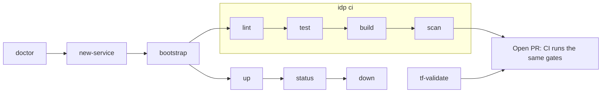

# AI Engineering Specification: Developer Experience

| Field | Value |
|---|---|
| Spec ID | DX |
| Status | Accepted (implemented) |
| Owner | Platform team (`/scripts/` → `@platform-team`) |
| Last updated | 2026-10-10 |
| Related specs | [platform-spec.md](platform-spec.md) · [repo-template-spec.md](repo-template-spec.md) · [workflow-spec.md](workflow-spec.md) · [governance-spec.md](governance-spec.md) · [terraform-modules-spec.md](terraform-modules-spec.md) |
| Related ADRs | ADR-0003 (onboarding model) |

---

## 1. Purpose & Scope

Make the platform self-service: an engineer can check prerequisites, scaffold a service, set up a local
environment, run the same gates as CI, and run the app with a database locally — without asking the platform
team. In scope: `scripts/idp.py` (stdlib-only CLI), its wrappers (`scripts/idp.ps1`, `scripts/idp`), the
legacy PowerShell wrappers, the local run paths, and documentation standards.

## 2. Business Problem Addressed

| Problem | Contribution |
|---|---|
| BP5 Long onboarding | `doctor` → `new-service` → `bootstrap` → `ci` in minutes. |
| BP6 High maintenance | One CLI replaces per-team scripts; no tickets to the platform team. |
| BP1 Duplicate pipelines | `idp ci` mirrors the reusable workflow steps instead of bespoke local scripts. |
| BP3 Different repo structures | `list-services` + `--app` work on any service with a `requirements.txt`. |

## 3. Context / Current State

- `scripts/idp.py`: Python standard library only (argparse, subprocess, urllib…). Run from any CWD; paths are
  resolved relative to the repo root.
- Wrappers: `scripts/idp.ps1` (Windows; finds `python` or `py`, propagates exit code) and `scripts/idp`
  (POSIX; `exec python3`).
- Legacy PowerShell scripts kept for compatibility are thin wrappers with one implementation per command:
  `bootstrap.ps1 [-App]` → `idp bootstrap`, `new-service.ps1 -Name [-OutputPath]` → `idp new-service`,
  `security-scan.ps1 [-AppDir] [-TerraformDir]` → `idp scan`, `validate-terraform.ps1` → `idp tf-validate`.
- Container runtime auto-detected: `podman` preferred, else `docker`.
- Colour output only on a TTY; disabled by `NO_COLOR`.

## 4. Requirements

| ID | Level | Requirement |
|---|---|---|
| DX-R1 | MUST | The CLI runs on a fresh clone with only Python 3.10+ (warns below 3.10) and git; container commands additionally need podman or docker; `tf-validate` needs terraform. |
| DX-R2 | MUST | Every command fails loudly: non-zero exit and an `ERROR:` message on stderr. |
| DX-R3 | MUST | `lint`, `test`, `build`, `scan`, `tf-validate` execute the same tools/flags as CI (ruff, pytest, image build, Gitleaks/Trivy/Checkov, fmt/init/validate). |
| DX-R4 | MUST | `new-service` never overwrites an existing directory and validates the name (see repo-template-spec.md TPL-R8). |
| DX-R5 | MUST | Service-scoped commands accept `--app <dir>` (default `app/ims`) and refuse directories without `requirements.txt`. |
| DX-R6 | MUST | `lint`/`test` use the service's `.venv` interpreter when present, else the current Python. |
| DX-R7 | MUST | `up` starts Postgres + API, waits for `/health` (60 s), and reports the JSON body or fails with a logs hint. |
| DX-R8 | SHOULD | The local demo path (§6) completes in < 10 minutes with prerequisites installed. |
| DX-R9 | SHOULD | Every module, workflow, script and app has a README or header docstring with purpose, inputs, side effects, and an example. |
| DX-R10 | SHOULD | Diagrams are Mermaid in Markdown (diffable, renders on GitHub). |
| DX-R11 | MAY | Extra pytest args may be passed through `idp test <args...>`. |

## 5. Interfaces / Contracts

`python scripts/idp.py <command> [options]` (or `./scripts/idp.ps1 …`, `./scripts/idp …`).

| Command | Options (default) | What it does |
|---|---|---|
| `doctor` | — | Checks `python`, `git` (required), `podman\|docker`, `terraform` (optional); fails if required missing |
| `list-services` | — | Lists dirs with `requirements.txt` (excl. `.venv`, `node_modules`), labelled `service`/`template` |
| `new-service <name>` | `--output DIR` (`<repo>/../<name>`), `--git` | Scaffold from template, replace `TODO-service-name` |
| `bootstrap` | `--app` (`app/ims`) | Create `<app>/.venv`, upgrade pip, install `requirements-dev.txt` (else `requirements.txt`), copy `.env.example` → `.env` if absent |
| `lint` | `--app` | `python -m ruff check .` in app dir |
| `test` | `--app`, `[pytest_args...]` | `python -m pytest -q …` in app dir |
| `build` | `--app`, `--tag` (`<app-dir-name>:local`) | `<runtime> build -t <tag> -f <app>/Dockerfile <app>` |
| `up` | `--app`, `--port` (`3000`) | Network `ims-net`; container `ims-db` (`postgres:16.4-bookworm`, user/pass/db `ims`); build `<name>:local`; wait `pg_isready`; run `<name>-api` with `PGHOST=ims-db …` mapped `<port>:3000`; poll `/health` |
| `down` | `--app` | Remove `<name>-api`, `ims-db`, network `ims-net` |
| `status` | `--port` (`3000`) | GET `http://localhost:<port>/health` (3 s) |
| `scan` | `--app`, `--terraform-dir` (`infrastructure`), `--skip-iac` | Gitleaks (report `security-reports/gitleaks-report.json`), Trivy fs CRITICAL/HIGH on `--app`, Checkov on terraform dir; aggregates failures |
| `tf-validate` | — | `terraform fmt -check -recursive` in `infrastructure/`, then `init -backend=false -input=false` + `validate` for the 6 modules and `environments/dev` |
| `ci` | `--app`, `--skip-containers` | `lint` → `test` → (unless skipped) `build` → `scan` (with IaC) |

Exit codes: 0 success; the failing subprocess's code, or 1, on failure; 130 on Ctrl-C.

Local environment (`app/ims/.env.example`): `PORT=3000`, `API_KEY=demo-key`, `PGHOST=localhost`,
`PGPORT=5432`, `PGUSER=ims`, `PGPASSWORD=ims`, `PGDATABASE=ims`. Without `PGHOST`/`DATABASE_URL` the app uses
SQLite (`inventory.db`). Note: `create_app()` reads `os.environ` only; it does not load `.env` itself.

## 6. Design Details

Local demo path:

1. `python scripts/idp.py doctor`
2. `python scripts/idp.py bootstrap`
3. `python scripts/idp.py ci --skip-containers` (ruff + 6 tests)
4. `python scripts/idp.py up` → open `http://localhost:3000/` (UI) or `curl http://localhost:3000/health`,
   `curl http://localhost:3000/api/v1/products` (see `app/ims/openapi.yaml`). Alternative:
   `docker compose -f app/ims/docker-compose.yml up --build` (or `podman compose`).
5. Write: `curl -X POST -H "X-API-Key: demo-key" -H "Content-Type: application/json" -d '{"sku":"AB-1","name":"Widget","quantity":5,"price":2.5}' http://localhost:3000/api/v1/products`
6. `python scripts/idp.py scan`, `python scripts/idp.py tf-validate`
7. `python scripts/idp.py down`

## 7. Security Considerations

- `scan` mounts the repo read/write into scanner containers (needed for the Gitleaks report); scanner images
  are currently `:latest` (governance-spec.md GOV-R15).
- `up` uses fixed local credentials (`ims`/`ims`) on an isolated container network; Postgres is not
  published to the host by `idp up` (docker-compose does publish 5432).
- `.env` is gitignored; `bootstrap` never overwrites an existing `.env`.
- Subprocesses are invoked with argument lists (no shell), avoiding injection via names/paths.

## 8. Non-Functional Requirements

| ID | Requirement |
|---|---|
| DX-N1 | No third-party Python dependencies for the CLI itself. |
| DX-N2 | Cross-platform: Windows (PowerShell 5.1 wrapper), macOS, Linux. |
| DX-N3 | Each step prints the command it runs (`$ …`) for transparency. |
| DX-N4 | `--help` available for every command. |

## 9. Acceptance Criteria / Validation

| # | Check | Command | Result (2026-10-10) |
|---|---|---|---|
| 1 | CLI help | `python scripts/idp.py -h` | Pass |
| 2 | Lint + tests | `python scripts/idp.py ci --skip-containers` | Pass (ruff clean, 6/6) |
| 3 | Template | `python scripts/idp.py ci --app templates/service-repo-template/app --skip-containers` | Pass (1/1) |
| 4 | Doctor | `python scripts/idp.py doctor` | Runs; terraform reported optional/missing on authoring machine |
| 5 | Terraform | `python scripts/idp.py tf-validate` | Not run (terraform not installed) |
| 6 | Containers | `python scripts/idp.py up` / `status` / `down`, `scan`, `ci` | Not re-verified after Python migration |

## 10. Out of Scope / Future Work

- Hosted portal (Backstage) or chat-ops front end for the same commands.
- `idp up` support for non-IMS services (DB name/creds are IMS-specific today); `idp deploy`.
- Pin scanner images; Trivy image scan in `idp scan`; `idp tf-validate` for scaffolded repos.
- Auto-load `.env` in the app (e.g. python-dotenv) for non-container runs.
- Pre-commit integration.

## 11. Instructions for AI Coding Agents

- Use `idp` commands rather than ad-hoc shell for lint/test/build/scan; report results with the exact command.
- When adding a CLI command or flag: add it in `build_parser()`, keep stdlib-only, fail via `die()`, update
  the §5 table, the module docstring, and the root README.
- Keep CLI ↔ CI parity (workflow-spec.md WF-R10); a change to CI steps requires the matching CLI change.
- Never make `new-service` overwrite, and never print secrets.
- If a tool (terraform, podman/docker) is unavailable, say which checks were skipped.

## 12. Change Log

| Date | Change |
|---|---|
| 2026-10-10 | Added `scripts/idp.py` CLI (doctor, list-services, new-service, bootstrap, lint, test, build, up/down/status, scan, tf-validate, ci) with `idp.ps1`/`idp` wrappers; `bootstrap.ps1` became a thin wrapper (other legacy ps1 scripts still standalone); IMS migrated to Python/Flask (endpoints under `/api/v1`). Rewritten to 12 sections. |
| Earlier | Four PowerShell scripts, Node-based local path. |
