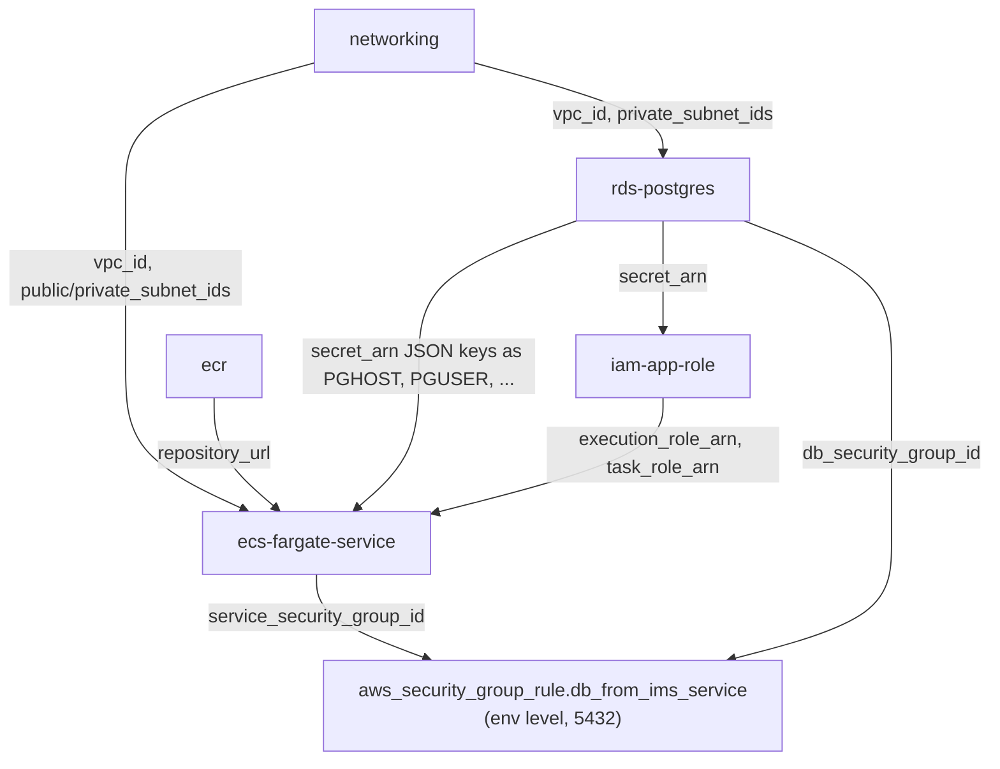

# AI Engineering Specification: Terraform Modules

| Field | Value |
|---|---|
| Spec ID | TF |
| Status | Accepted (implemented; statically validated in CI) |
| Owner | Platform team (`/infrastructure/` → `@platform-team`) |
| Last updated | 2026-10-10 |
| Related specs | [platform-spec.md](platform-spec.md) · [workflow-spec.md](workflow-spec.md) (Terraform CI) · [governance-spec.md](governance-spec.md) (Checkov gate) · [repo-template-spec.md](repo-template-spec.md) (consumer `main.tf`) |
| Related ADRs | ADR-0001 (AWS + ECS Fargate), ADR-0004 (Checkov) |

---

## 1. Purpose & Scope

Define the shared library of Terraform modules under `infrastructure/modules/` that every application
composes to provision AWS infrastructure, plus the reference composition in `infrastructure/environments/dev`.
In scope: module interfaces, defaults, security baselines, naming/tagging, versioning, and validation.
Out of scope: remote state backends, `plan`/`apply` pipelines (see §10).

## 2. Business Problem Addressed

| Problem | Contribution |
|---|---|
| BP2 Duplicate Terraform | One implementation per resource type; environments pass variables only. |
| BP6 High maintenance | A fix in a module reaches every consumer on a `ref` bump. |
| BP3 Different repo structures | The template's `infrastructure/` has the same shape as `environments/dev`. |
| BP5 Long onboarding | A new service gets VPC, registry, DB, IAM, and compute by editing ~5 variables. |

## 3. Context / Current State

- Cloud: AWS, region caller-supplied (`aws_region`, default `us-east-1` in `environments/dev`).
- Every module declares `terraform { required_version = ">= 1.5.0" }` and `hashicorp/aws ~> 5.0` in its
  `main.tf`; `rds-postgres` also requires `hashicorp/random`.
- Each module directory has `main.tf`, `variables.tf`, `outputs.tf`, `README.md`.
- CI (`terraform.yml`) runs `reusable-terraform.yml` per module, then the `dev` environment, with
  Terraform 1.9.5: `fmt -check -recursive`, `init -backend=false`, `validate`, Checkov (`soft_fail: false`).
- Accepted Checkov exceptions are inline `# checkov:skip=<ID>: <reason>` comments in `main.tf`.
- No `apply` has been performed (no AWS account for the capstone). Terraform is **not installed** on the
  authoring machine, so local `idp tf-validate` was not run for this revision.

## 4. Requirements

| ID | Level | Requirement |
|---|---|---|
| TF-R1 | MUST | Each module declares `required_version >= 1.5.0` and pins `hashicorp/aws ~> 5.0` (plus any other provider it uses). |
| TF-R2 | MUST | Every variable has `description` and `type`; every output has `description`. |
| TF-R3 | MUST | No module hardcodes region, account ID, credentials, or secrets. Providers are configured only in environments. |
| TF-R4 | MUST | Data-at-rest resources encrypt by default: S3 SSE `aws:kms`, RDS `storage_encrypted = true`, ECR `encryption_type = "KMS"`. |
| TF-R5 | MUST | `rds-postgres` places the DB in caller-supplied private subnets, `publicly_accessible = false`, generates the password with `random_password`, and stores credentials in Secrets Manager. |
| TF-R6 | MUST | `iam-app-role` grants task permissions only for `allowed_actions` × `allowed_resources`; if either list is empty no task policy is created. |
| TF-R7 | MUST | `ecs-fargate-service` enables Container Insights and ships container logs to a dedicated CloudWatch log group. |
| TF-R8 | MUST | Modules are composed, not forked. In-repo environments use `source = "../../modules/<name>"`; external consumers use `git::https://github.com/<org>/group1-advanced.git//infrastructure/modules/<name>?ref=modules/v1.0.0`. |
| TF-R9 | MUST | Cross-module cycles are broken at the environment level (e.g. the DB ingress rule from the service SG is an `aws_security_group_rule` in the environment, not inside either module). |
| TF-R10 | MUST | Every Checkov suppression is inline and carries a reason; suppressions are never applied by disabling the scan. |
| TF-R11 | SHOULD | Destructive-protection flags (`deletion_protection`, `enable_deletion_protection`) default to `false` for dev and are set `true` for long-lived environments. |
| TF-R12 | SHOULD | Optional hardening (TLS, access logs, CMK) is exposed as nullable variables rather than forced, so the module validates without a domain/bucket/key. |
| TF-R13 | MUST | Resource names use the prefix `<environment>-<app>` (e.g. `dev-ims`, `dev-ims-db`) and all resources receive tags `Environment`, `Application`, `ManagedBy = "terraform"` (+ `Repository` in this repo). |
| TF-R14 | MAY | New modules MAY be added if they follow TF-R1..R13 and are added to `terraform.yml` and `TF_TARGETS` in `scripts/idp.py`. |

## 5. Interfaces / Contracts

Variables without a default are required.

### 5.1 `networking`
| Variable | Type | Default | Notes |
|---|---|---|---|
| `name` | string | — | name prefix |
| `vpc_cidr` | string | `"10.0.0.0/16"` | |
| `az_count` | number | `2` | public + private subnet per AZ |
| `tags` | map(string) | `{}` | |

Outputs: `vpc_id`, `public_subnet_ids`, `private_subnet_ids`.
Resources: VPC, IGW, public/private subnets, EIP + NAT gateway, route tables, locked-down
`aws_default_security_group`, VPC Flow Logs → CloudWatch (with IAM role).

### 5.2 `ecr`
| Variable | Type | Default | Notes |
|---|---|---|---|
| `name` | string | — | repository name |
| `image_tag_mutability` | string | `"IMMUTABLE"` | validated: `MUTABLE` or `IMMUTABLE` |
| `max_image_count` | number | `20` | lifecycle keeps N tagged images |
| `tags` | map(string) | `{}` | |

Outputs: `repository_url`, `repository_arn`. `scan_on_push = true`; KMS encryption; lifecycle also expires
untagged images after 14 days.

### 5.3 `iam-app-role`
| Variable | Type | Default | Notes |
|---|---|---|---|
| `name` | string | — | role name prefix |
| `allowed_actions` | list(string) | `[]` | task-role actions |
| `allowed_resources` | list(string) | `[]` | ARNs those actions apply to; also scopes execution-role secret access |
| `tags` | map(string) | `{}` | |

Outputs: `execution_role_arn`, `task_role_arn`. Execution role: AWS managed ECS execution policy + inline
secrets policy (only when `allowed_resources` non-empty). Task role: inline policy only when both lists are
non-empty. Trust: `ecs-tasks.amazonaws.com`.

### 5.4 `rds-postgres`
| Variable | Type | Default | Notes |
|---|---|---|---|
| `identifier` | string | — | e.g. `dev-ims-db` |
| `db_name` | string | — | default database |
| `vpc_id` | string | — | |
| `subnet_ids` | list(string) | — | private subnets only |
| `allowed_security_group_ids` | list(string) | `[]` | empty ⇒ no ingress |
| `instance_class` | string | `"db.t4g.micro"` | |
| `allocated_storage` | number | `20` | GiB |
| `engine_version` | string | `"16.4"` | |
| `multi_az` | bool | `false` | |
| `deletion_protection` | bool | `false` | |
| `master_username` | string | `"ims_admin"` | |
| `tags` | map(string) | `{}` | |

Outputs: `endpoint`, `port`, `db_name`, `secret_arn`, `db_security_group_id`.
Secret `<identifier>-credentials` JSON keys: `username`, `password`, `host`, `port`, `dbname`.
Also: parameter group, Enhanced Monitoring role, Performance Insights.

### 5.5 `s3-bucket`
| Variable | Type | Default | Notes |
|---|---|---|---|
| `bucket_name` | string | — | globally unique |
| `versioning_enabled` | bool | `true` | |
| `force_destroy` | bool | `false` | dev/ephemeral only |
| `access_log_bucket_id` | string | `null` | null ⇒ no access logging |
| `tags` | map(string) | `{}` | |

Outputs: `bucket_id`, `bucket_arn`. SSE `aws:kms`, public access block, lifecycle (abort incomplete multipart
after 7 days, expire noncurrent versions after 90 days). Not used by `environments/dev` today.

### 5.6 `ecs-fargate-service`
| Variable | Type | Default | Notes |
|---|---|---|---|
| `name` | string | — | prefix for cluster/service/ALB |
| `image_url` | string | — | full image URL incl. tag |
| `container_port` | number | `3000` | |
| `health_check_path` | string | `"/health"` | ALB target group |
| `cpu` | number | `256` | |
| `memory` | number | `512` | MiB |
| `desired_count` | number | `1` | |
| `vpc_id` | string | — | |
| `public_subnet_ids` | list(string) | — | ALB |
| `private_subnet_ids` | list(string) | — | tasks |
| `alb_ingress_cidr_blocks` | list(string) | `["0.0.0.0/0"]` | restrict in real deployments |
| `execution_role_arn` | string | — | from `iam-app-role` |
| `task_role_arn` | string | — | from `iam-app-role` |
| `environment` | map(string) | `{}` | non-secret env vars |
| `secrets` | map(string) | `{}` | env name → Secrets Manager ARN (`valueFrom`) |
| `log_retention_days` | number | `400` | |
| `log_kms_key_id` | string | `null` | |
| `certificate_arn` | string | `null` | set ⇒ HTTPS :443 + :80 redirect |
| `access_logs_bucket_id` | string | `null` | |
| `enable_deletion_protection` | bool | `false` | ALB |
| `tags` | map(string) | `{}` | |

Outputs: `alb_dns_name`, `service_name`, `cluster_name`, `service_security_group_id`.

### 5.7 `environments/dev`
| Variable | Type | Default |
|---|---|---|
| `aws_region` | string | `"us-east-1"` |
| `app_name` | string | `"ims"` |
| `environment_name` | string | `"dev"` |
| `container_image_tag` | string | `"latest"` |
| `container_port` | number | `3000` |

Outputs: `alb_dns_name`, `ecr_repository_url`, `db_endpoint`, `db_secret_arn`.
Example values: `terraform.tfvars.example`.

## 6. Design Details

Dev composition: `local.name = "${environment_name}-${app_name}"` → `dev-ims`; `iam` grants
`secretsmanager:GetSecretValue` on the DB secret only; the service gets `PORT` as plain env.

## 7. Security Considerations

- Encryption at rest everywhere (TF-R4); RDS private + SG-gated (TF-R5, TF-R9).
- Default SG of the VPC is locked down; VPC Flow Logs enabled.
- Least-privilege IAM (TF-R6); no `*:*`.
- Documented Checkov exceptions (all inline): ECS module — CKV_AWS_158, 260, 382, 150, 91, 103, 2, 378,
  CKV2_AWS_28, CKV2_AWS_20; networking — CKV_AWS_130, 158; rds-postgres — CKV_AWS_382, 354, 157, 293, 161,
  149, CKV2_AWS_57; s3-bucket — CKV_AWS_144, CKV2_AWS_62. Each is either opt-in via a variable or needs
  resources (cert, CMK, WAF, rotation Lambda) out of scope for dev.
- `alb_ingress_cidr_blocks` defaults open; real deployments MUST restrict it.

## 8. Non-Functional Requirements

| ID | Requirement |
|---|---|
| TF-N1 | Every module validates with `init -backend=false` (no credentials needed). |
| TF-N2 | Dev defaults minimise cost (single NAT, t4g.micro, 1 task). |
| TF-N3 | `terraform destroy` works on dev without manual flag flips (protection flags default false). |
| TF-N4 | Module READMEs list inputs, outputs, and deferred hardening. |

## 9. Acceptance Criteria / Validation

| # | Check | Command | Status |
|---|---|---|---|
| 1 | Formatting | `terraform fmt -check -recursive` (in `infrastructure/`) | Enforced in CI; not run locally (terraform not installed) |
| 2 | Validate 6 modules + dev | `python scripts/idp.py tf-validate` | Not run locally; CI `terraform.yml` runs it per directory |
| 3 | Checkov | `python scripts/idp.py scan` (Checkov on `infrastructure`) or CI | Zero unsuppressed findings expected; not re-run this revision |
| 4 | Interface tables match code | `grep -E '^(variable|output)' infrastructure/modules/*/*.tf` | Verified 2026-10-10 |
| 5 | Reuse | template `infrastructure/main.tf` uses the same modules with variables only | Verified |

## 10. Out of Scope / Future Work

- Remote state (S3 + DynamoDB lock), `plan` on PR and gated `apply` via OIDC.
- Secret rotation Lambda; customer-managed KMS keys; WAF.
- Known gaps:
  - `container_image_tag` defaults to `latest` while ECR defaults to `IMMUTABLE`; deploy with a commit SHA tag.
  - Template `main.tf` uses placeholder `<org>` git sources, so `terraform init` fails until replaced.
- Publish modules to a private registry with semantic versions.

## 11. Instructions for AI Coding Agents

- Read the target module's `variables.tf`/`outputs.tf`/`README.md` before changing it; update §5 here in the
  same change.
- Never add a provider block inside a module; never hardcode ARNs/regions/account IDs.
- Adding a variable: include `description`, `type`, and a safe default if optional; keep backward compatibility
  (a removed/renamed variable is a breaking change → major tag bump).
- New Checkov finding: fix it; suppress only with an inline reasoned `checkov:skip` and note it in §7.
- Register any new module in `.github/workflows/terraform.yml` and `TF_TARGETS` in `scripts/idp.py`.
- Run `python scripts/idp.py tf-validate`; if terraform is unavailable, say so explicitly.

## 12. Change Log

| Date | Change |
|---|---|
| 2026-10-10 | Rewritten to 12-section structure; full variable/output tables from code; Checkov exception inventory; known gaps (image tag); DB secret keys now mapped to `PG*` via `<arn>:<key>::`; `idp tf-validate` added alongside `validate-terraform.ps1`. App runtime migrated to Python/Flask (port/health unchanged). |
| Earlier | Initial module catalog. |
