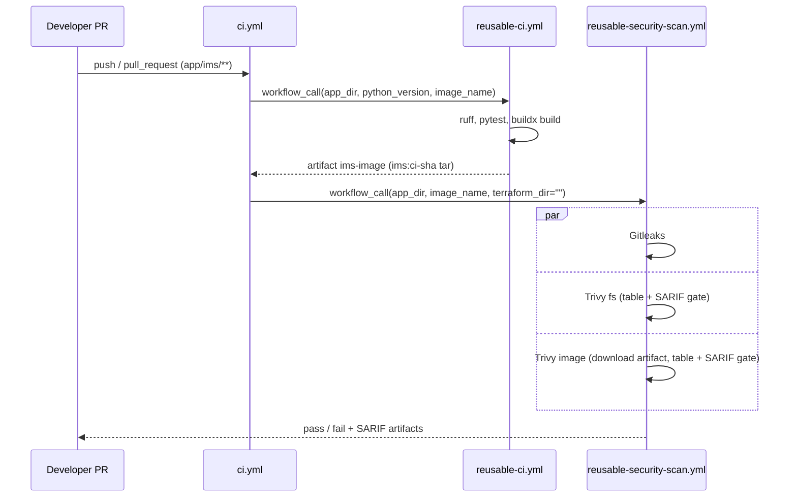
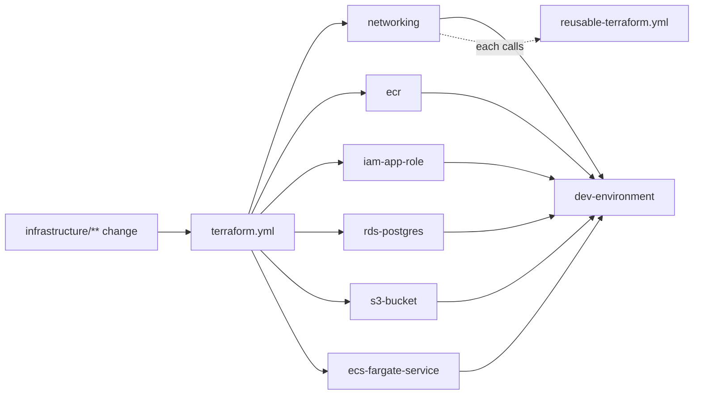

# AI Engineering Specification: CI/CD Workflows

| Field | Value |
|---|---|
| Spec ID | WF |
| Status | Accepted (implemented) |
| Owner | Platform team (`/.github/workflows/` → `@platform-team`) |
| Last updated | 2026-10-10 |
| Related specs | [platform-spec.md](platform-spec.md) · [governance-spec.md](governance-spec.md) · [terraform-modules-spec.md](terraform-modules-spec.md) · [repo-template-spec.md](repo-template-spec.md) · [developer-experience-spec.md](developer-experience-spec.md) |
| Related ADRs | ADR-0002 (reusable workflow strategy), ADR-0004 (security tooling) |

---

## 1. Purpose & Scope

Define the shared GitHub Actions workflows that every application uses for CI, security scanning, and
Terraform validation, and the thin caller workflows that consume them. In scope: `.github/workflows/*.yml` and
the template's `.github/workflows/*.yml`. Out of scope: deployment (CD) — see §10.

## 2. Business Problem Addressed

| Problem | Contribution |
|---|---|
| BP1 Duplicate pipelines | All logic in 3 `reusable-*.yml` files; callers contain only `uses:` + `with:`. |
| BP6 High maintenance | A pipeline fix is made once and inherited by every caller. |
| BP3 Different repo structures | Every repo has the same two caller files (`ci.yml`, `terraform.yml`). |
| BP5 Long onboarding | New teams set 2–3 inputs to get full CI + security. |

## 3. Context / Current State

| File | Trigger | Role |
|---|---|---|
| `reusable-ci.yml` | `workflow_call` | ruff + pytest + image build, uploads image tarball |
| `reusable-security-scan.yml` | `workflow_call` | Gitleaks, Trivy fs, Trivy image, Checkov (optional) |
| `reusable-terraform.yml` | `workflow_call` | fmt / init / validate / Checkov for one directory |
| `ci.yml` | push to `main`/`master`, PR; paths `app/ims/**` and the 3 CI workflow files | calls CI then security scan for IMS |
| `terraform.yml` | push to `main`/`master`, PR; paths `infrastructure/**`, `terraform.yml`, `reusable-terraform.yml` | 6 module jobs + `dev-environment` job (`needs` all 6) |
| template `ci.yml` | push to `main`/`master`, all PRs | calls remote reusable CI + security scan (`<org>/group1-advanced/...@main`) |
| template `terraform.yml` | push/PR on `infrastructure/**` | calls remote reusable-terraform on `infrastructure` |

All workflows set top-level `permissions: contents: read`. Runner: `ubuntu-latest`.

## 4. Requirements

| ID | Level | Requirement |
|---|---|---|
| WF-R1 | MUST | Build, test, scan, and Terraform logic lives only in `reusable-*.yml`; caller workflows contain only triggers, `permissions`, and `jobs.*.uses/with/needs`. |
| WF-R2 | MUST | Third-party actions are pinned to an explicit version tag (current practice: major tags such as `@v4`, and `aquasecurity/trivy-action@v0.36.0`); never `@main`/`@master`. SHOULD move to full commit SHAs. |
| WF-R3 | MUST | Security scans run on every pull request touching the app (shift-left). |
| WF-R4 | MUST | Every workflow declares least-privilege `permissions` (`contents: read`). |
| WF-R5 | MUST | Secrets are referenced only through `${{ secrets.* }}`. None are required today. |
| WF-R6 | MUST | Gates fail closed: Trivy enforced steps use `exit-code: "1"`, Checkov `soft_fail: false`, Gitleaks fails on findings. |
| WF-R7 | MUST | Each Trivy scan runs twice: a human-readable `table` step (`exit-code: "0"`, `if: always()`) and an enforced `sarif` step; SARIF is uploaded with `if: always()` (7-day retention). |
| WF-R8 | MUST | The image is built once in `reusable-ci.yml` and handed to the security scan as an artifact named `<image_name>-image` (tag `<image_name>:ci-<sha>`), so the scanned image is the tested image. |
| WF-R9 | MUST | Workflow YAML parses as valid YAML. |
| WF-R10 | SHOULD | `python scripts/idp.py ci` reproduces the same lint/test/build/scan steps locally. |
| WF-R11 | SHOULD | External consumers pin `@workflows/v1.0.0` instead of `@main` once tagged. |
| WF-R12 | MAY | Callers MAY pass `terraform_dir: ""` to skip Checkov in the app pipeline when IaC is validated by `terraform.yml` (as IMS does). |

## 5. Interfaces / Contracts

### 5.1 `reusable-ci.yml`
| Input | Type | Required | Default | Description |
|---|---|---|---|---|
| `app_dir` | string | yes | — | App directory (working dir for all `run` steps, build context) |
| `python_version` | string | no | `"3.12"` | `actions/setup-python` version |
| `image_name` | string | yes | — | Image name; tag is `ci-${{ github.sha }}` |

Job `lint-test-build` steps: `actions/checkout@v4` → `actions/setup-python@v5` (pip cache keyed on
`<app_dir>/requirements*.txt`) → install `requirements-dev.txt` (fallback: `requirements.txt pytest ruff`) →
`ruff check .` → `python -m pytest -q` → `docker/setup-buildx-action@v3` → `docker/build-push-action@v6`
(`push: false`, `outputs: type=docker,dest=/tmp/<image_name>-image.tar`) → `actions/upload-artifact@v4`
(`<image_name>-image`, retention 3 days). Outputs: artifact only (no `outputs:` block).

### 5.2 `reusable-security-scan.yml`
| Input | Type | Required | Default | Description |
|---|---|---|---|---|
| `app_dir` | string | yes | — | Trivy fs scan target |
| `image_name` | string | yes | — | Artifact/image to scan |
| `terraform_dir` | string | no | `""` | Checkov target; empty skips the job |

| Job | Tool / action | Gate | Artifact |
|---|---|---|---|
| `secrets-scan` | `gitleaks/gitleaks-action@v2`, `fetch-depth: 0` | any secret | Gitleaks upload enabled |
| `dependency-scan` | `aquasecurity/trivy-action@v0.36.0`, `scan-type: fs` | CRITICAL,HIGH | `trivy-fs-results` |
| `image-scan` | download `<image_name>-image`, `docker load`, Trivy `image-ref: <image_name>:ci-<sha>` | CRITICAL,HIGH | `trivy-image-results` |
| `terraform-scan` | `bridgecrewio/checkov-action@v12`, `framework: terraform` (only if `terraform_dir != ''`) | any failed check | `checkov-results` |

The artifact handoff works because the caller declares `security-scan: needs: ci` within the same run.

### 5.3 `reusable-terraform.yml`
| Input | Type | Required | Description |
|---|---|---|---|
| `working_dir` | string | yes | Module or environment directory |

Job `validate`: checkout → `hashicorp/setup-terraform@v3` (`terraform_version: "1.9.5"`) →
`terraform fmt -check -recursive` → `terraform init -backend=false` → `terraform validate` →
`bridgecrewio/checkov-action@v12` (`soft_fail: false`).

### 5.4 Callers
| Caller | Job → reusable | `with:` |
|---|---|---|
| `ci.yml` | `ci` → reusable-ci | `app_dir: app/ims`, `python_version: "3.12"`, `image_name: ims` |
| `ci.yml` | `security-scan` (`needs: ci`) → reusable-security-scan | `app_dir: app/ims`, `image_name: ims`, `terraform_dir: ""` |
| `terraform.yml` | `networking`, `ecr`, `iam-app-role`, `rds-postgres`, `s3-bucket`, `ecs-fargate-service` | `working_dir: infrastructure/modules/<job>` |
| `terraform.yml` | `dev-environment` (`needs` all six) | `working_dir: infrastructure/environments/dev` |
| template `ci.yml` | `ci`, `security-scan` | `app_dir: app`, `python_version: "3.12"`, `image_name: TODO-service-name`, `terraform_dir: infrastructure` |
| template `terraform.yml` | `validate` | `working_dir: infrastructure` |

## 6. Design Details

Dockerfile contract (verified by building in `reusable-ci.yml`, scanned by Trivy image): multi-stage, base
`python:3.12-alpine`, `apk upgrade`, non-root uid 1001, pip/setuptools/wheel removed, `HEALTHCHECK` on
`/health`, `EXPOSE 3000`, gunicorn `CMD`.

## 7. Security Considerations

- `permissions: contents: read` only; no `id-token`, no write scopes, no secrets.
- Images are never pushed from CI (`push: false`).
- Gitleaks uses full history (`fetch-depth: 0`).
- Version tags (not SHAs) are a residual supply-chain risk; tracked under §10.
- Checkov in `reusable-terraform.yml` has no SARIF upload (log only).

## 8. Non-Functional Requirements

| ID | Requirement |
|---|---|
| WF-N1 | Path filters keep IMS CI and Terraform CI independent (no unnecessary runs). |
| WF-N2 | pip cache via `setup-python` keeps CI install time low. |
| WF-N3 | Failures are self-explanatory from logs (table output before gates). |
| WF-N4 | Artifact retention: image 3 days, scan results 7 days. |

## 9. Acceptance Criteria / Validation

| # | Check | Command / method | Result (2026-10-10) |
|---|---|---|---|
| 1 | YAML parses (repo + template) | `python -c "import yaml,glob;[yaml.safe_load(open(f)) for f in glob.glob('.github/workflows/*.yml')+glob.glob('templates/service-repo-template/.github/workflows/*.yml')]"` | Pass |
| 2 | Callers are inputs-only | inspect `ci.yml`, `terraform.yml` (no `steps:`) | Pass |
| 3 | Lint step equivalent | `python scripts/idp.py lint` | Pass (ruff clean) |
| 4 | Test step equivalent | `python scripts/idp.py test` | Pass, 6/6 |
| 5 | Template CI equivalent | `python scripts/idp.py ci --app templates/service-repo-template/app --skip-containers` | Pass (1/1 test) |
| 6 | Build + scan equivalent | `python scripts/idp.py ci` | Not re-verified after Python migration |
| 7 | Terraform job equivalent | `python scripts/idp.py tf-validate` | Not run locally (terraform not installed) |

## 10. Out of Scope / Future Work

- CD: push to ECR via OIDC (`id-token: write`), `terraform plan` on PR, gated `apply`.
- Pin all actions by commit SHA; Dependabot for actions.
- Upload SARIF to GitHub code scanning (`security-events: write`).
- Matrix-driven `terraform.yml` from directory discovery.
- Cut `workflows/v1.0.0` tag; replace `<org>` and `@main` in the template.
- Workflow linting (`actionlint`) in CI.

## 11. Instructions for AI Coding Agents

- Put new steps in the reusable workflow and expose variation as a typed input with `description` (and
  default if optional); update §5 tables.
- Never add `steps:` to a caller workflow. Never weaken a gate (`exit-code`, `soft_fail`) to pass CI.
- Keep the artifact name/tag contract (`<image_name>-image`, `<image_name>:ci-<sha>`) in sync across both
  reusable workflows.
- Keep `scripts/idp.py` in parity (lint/test/build/scan) when changing CI steps.
- Validate with the YAML parse command in §9 and `python scripts/idp.py ci --skip-containers`.

## 12. Change Log

| Date | Change |
|---|---|
| 2026-10-10 | Rewritten; `reusable-ci.yml` now Python (`python_version` input replaces `node_version`; ruff + pytest); documented exact inputs/jobs/actions; `terraform.yml` documented as explicit jobs (not a matrix); local parity via `idp ci`. |
| Earlier | Initial Node-based workflow spec. |
