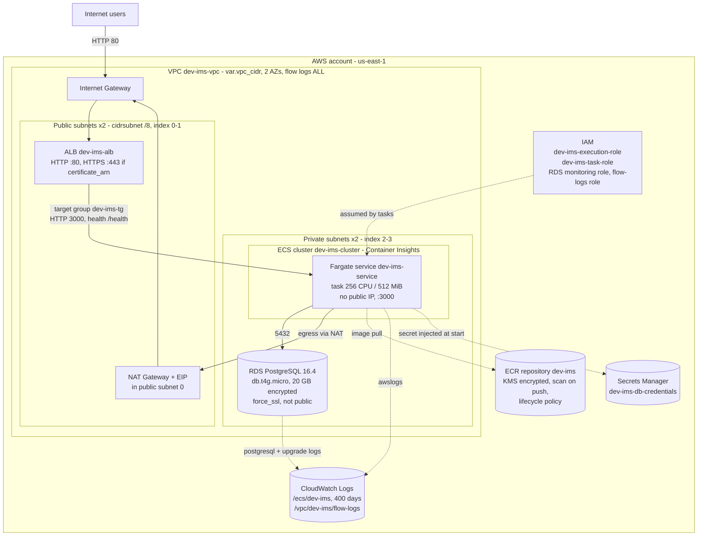

# AWS Deployment Architecture

The AWS target is defined in Terraform. `infrastructure/environments/dev/main.tf` composes the platform modules
for the IMS. Defaults: region `us-east-1`, `environment_name = dev`, `app_name = ims`, so every resource is
prefixed `dev-ims`. The task runs on container port `3000`, using image tag `container_image_tag` (default `latest`).

> Scope: this is the **designed** target. CI validates it (`terraform validate` plus Checkov) but never applies it.
> There is no remote state backend or deploy workflow yet (see [cicd-pipeline.md](cicd-pipeline.md#2-what-is-not-implemented-future-work)).

## 1. Topology

### Request path

1. The client connects to the ALB on port 80. Port 443 is used only if `certificate_arn` is set, and port 80 then
   returns a 301 redirect to HTTPS. The ALB has `drop_invalid_header_fields = true`.
2. The ALB forwards to the `ip` target group `dev-ims-tg` on port 3000. Health check: `GET /health`, matcher 200,
   every 15 s, healthy after 2 checks, unhealthy after 3. Because `/health` runs `SELECT 1`, a lost database
   connection makes the task fail its health check.
3. The Fargate task runs in a private subnet without a public IP and reaches Postgres on 5432.
4. Outbound traffic (ECR pull, Secrets Manager, CloudWatch) leaves through a single NAT gateway. There are no VPC
   endpoints today.

### Secrets path

`rds-postgres` generates the master password with `random_password` (24 characters). It stores
`{username, password, host, port, dbname}` as JSON in the `dev-ims-db-credentials` secret. The ECS task definition
lists that secret under `secrets`, so the ECS agent, using the execution role and its scoped
`secretsmanager:GetSecretValue` policy, injects it into the container at start. The secret is never in the image,
the task definition's plain `environment`, or the repo.

> The environment injects each JSON key of the RDS secret as its own variable, using ECS
> `valueFrom = "<secret_arn>:<key>::"`: `host` → `PGHOST`, `port` → `PGPORT`, `username` → `PGUSER`,
> `password` → `PGPASSWORD` and `dbname` → `PGDATABASE`. Those are exactly what `database_url_from_env()` reads.
> **Still open:** `API_KEY` is not injected yet, so the default `demo-key` would apply.

## 2. Security groups and traffic flow

| # | Source | Destination | Port / proto | Rule location |
|---|---|---|---|---|
| 1 | `alb_ingress_cidr_blocks` (default `0.0.0.0/0`) | `dev-ims-alb-sg` | 80/tcp | `ecs-fargate-service` `aws_security_group.alb` |
| 2 | `alb_ingress_cidr_blocks` | `dev-ims-alb-sg` | 443/tcp, only if `certificate_arn` set | same, dynamic ingress |
| 3 | `dev-ims-alb-sg` | `dev-ims-service-sg` | `container_port` 3000/tcp | `aws_security_group.service`, source SG only |
| 4 | `dev-ims-service-sg` | `dev-ims-db-sg` | 5432/tcp | Root `aws_security_group_rule.db_from_ims_service` in `environments/dev` |
| 5 | Any SG in `allowed_security_group_ids` | `dev-ims-db-sg` | 5432/tcp | `rds-postgres` dynamic ingress; dev passes none and uses rule 4 instead |
| 6 | ALB, service, DB SGs | `0.0.0.0/0` | all | Egress on each SG, with documented `CKV_AWS_382` skip |
| 7 | anything | VPC default SG | none | `aws_default_security_group` with no rules, which locks it down |

Rule 4 sits at the root on purpose. It breaks the `db` and `ims_service` dependency cycle, because neither module
references the other.

## 3. Module to resource mapping

| Module | Used by dev env as | Resources created |
|---|---|---|
| `networking` | `module.networking` (`az_count = 2`) | `aws_vpc` (DNS support and hostnames), `aws_internet_gateway`, 2x public `aws_subnet` (`map_public_ip_on_launch`), 2x private `aws_subnet`, `aws_eip` + `aws_nat_gateway` (single, AZ 0), public and private `aws_route_table` + associations, `aws_default_security_group` (locked down), `aws_flow_log` (ALL) to `aws_cloudwatch_log_group` `/vpc/<name>/flow-logs` (400 days) with its own IAM role and policy |
| `ecr` | `module.ecr` | `aws_ecr_repository` (`scan_on_push`, KMS encryption, `image_tag_mutability` variable), `aws_ecr_lifecycle_policy` (expire untagged after 14 days, keep the newest `max_image_count`) |
| `rds-postgres` | `module.db` (`identifier = dev-ims-db`, `db_name = ims`) | `random_password`, `aws_db_subnet_group` (private subnets), `aws_security_group` db, `aws_db_parameter_group` `postgres16` (`log_statement=ddl`, `rds.force_ssl=1`), enhanced-monitoring `aws_iam_role` + attachment, `aws_db_instance` (encrypted, private, Performance Insights, 60 s monitoring, log exports, `multi_az`/`deletion_protection` variables default false, `skip_final_snapshot = true`), `aws_secretsmanager_secret` + `aws_secretsmanager_secret_version` |
| `iam-app-role` | `module.iam` (`allowed_actions = secretsmanager:GetSecretValue`, `allowed_resources = [db secret]`) | Execution `aws_iam_role` + `AmazonECSTaskExecutionRolePolicy`, inline `execution_secrets` policy, task `aws_iam_role` + inline `task_scoped` policy |
| `ecs-fargate-service` | `module.ims_service` | `aws_ecs_cluster` (Container Insights), `aws_cloudwatch_log_group` `/ecs/<name>` (400 days, optional KMS), ALB and service `aws_security_group`, `aws_lb`, `aws_lb_target_group` (ip, HTTP), `aws_lb_listener` http and optional https (`ELBSecurityPolicy-TLS13-1-2-2021-06`), `aws_ecs_task_definition` (FARGATE, awsvpc, awslogs), `aws_ecs_service` (private subnets, no public IP) |
| `s3-bucket` | **Not used by `environments/dev`.** Available to teams, for example as the target for ALB `access_logs_bucket_id` | `aws_s3_bucket`, versioning, SSE-KMS with bucket key, full public access block, lifecycle (abort multipart after 7 days, expire noncurrent versions after 90 days), optional access logging |
| root (`environments/dev`) | n/a | `aws_security_group_rule.db_from_ims_service`. Outputs: `alb_dns_name`, `ecr_repository_url`, `db_endpoint`, `db_secret_arn` |

## 4. Resilience and cost choices for dev

| Choice | Dev default | For production |
|---|---|---|
| NAT gateways | 1, shared across AZs | One per AZ |
| RDS Multi-AZ | `false` | `multi_az = true` |
| Deletion protection, ALB and RDS | `false` | `true` |
| Final snapshot | skipped | Take one |
| ECS `desired_count` | 1 | 2 or more across AZs, plus auto scaling (future) |
| TLS | HTTP only | Set `certificate_arn` (ACM) |
| WAF | none | Attach a Web ACL (`CKV2_AWS_28` skip notes this) |

## 5. Future work

- A remote state backend (S3 + DynamoDB lock) and a deploy workflow using OIDC.
- VPC interface endpoints for ECR, Secrets Manager and Logs, to drop NAT dependency and cost.
- ECS service auto scaling, ALB access logs to an `s3-bucket` instance, and Secrets Manager rotation (`CKV2_AWS_57` skip).
