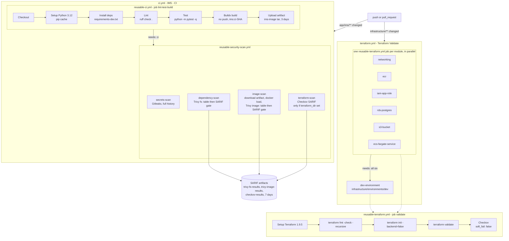
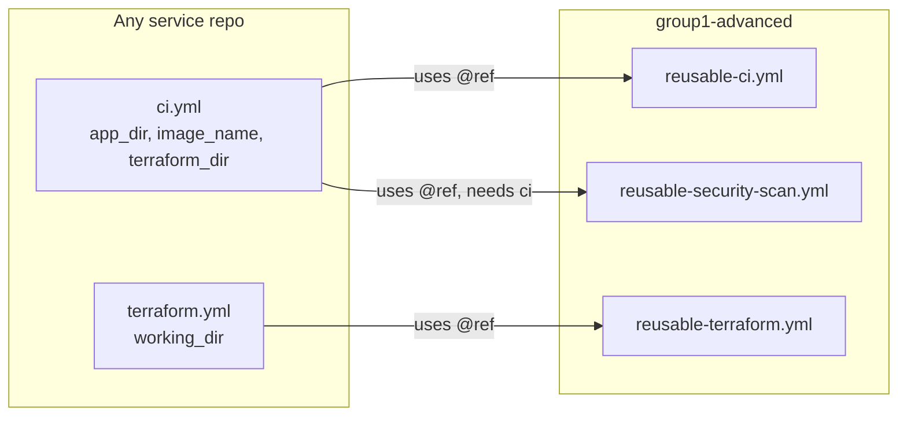

# CI/CD Pipeline Architecture

The pipeline is split into **caller workflows**, which are thin and specific to one repo, and **reusable
workflows** (`on: workflow_call`), which the platform owns and holds all the logic. Caller workflows only supply
inputs. This is what lets every service share the same gates (see ADR-0002).

| Workflow | Type | Trigger / inputs |
|---|---|---|
| `.github/workflows/ci.yml` ("IMS - CI") | Caller | `push` to `main`/`master` and `pull_request`, filtered to `app/ims/**` and the CI workflow files |
| `.github/workflows/terraform.yml` ("Infrastructure - Terraform Validate") | Caller | `push`/`pull_request` on `infrastructure/**` and the Terraform workflow files |
| `.github/workflows/reusable-ci.yml` | Reusable | `app_dir`, `python_version` (default `3.12`), `image_name` |
| `.github/workflows/reusable-security-scan.yml` | Reusable | `app_dir`, `image_name`, `terraform_dir` (optional, default `""`) |
| `.github/workflows/reusable-terraform.yml` | Reusable | `working_dir` |

All workflows declare `permissions: contents: read`.

## 1. End-to-end flow

### Design notes

- **Build once, scan what you built.** `reusable-ci.yml` exports the image as a Docker tar
  (`outputs: type=docker,dest=/tmp/<image_name>-image.tar`) and uploads it as `<image_name>-image`. The
  `image-scan` job downloads and `docker load`s that exact artifact, so Trivy scans the same bytes the tests ran
  against rather than a rebuild. This only works because the caller orders the jobs with `needs: ci` in the same
  workflow run.
- **Two-step Trivy.** Each Trivy scan runs twice. First with `format: table` and `exit-code: "0"`, with
  `if: always()`, so the log always shows a readable report. Then as the enforced gate with `exit-code: "1"`
  writing SARIF. That way a failure is never a bare red X.
- **Checkov runs in two places.** The app pipeline runs it only when `terraform_dir` is non-empty. IMS passes
  `""` because its infra is validated by `terraform.yml`. The template caller passes `terraform_dir: infrastructure`,
  so a single-repo service gets IaC scanning from its app CI. `reusable-terraform.yml` always runs Checkov.
- **Fan-out, then integrate.** `terraform.yml` validates every module on its own, in parallel, and only then the
  `dev-environment` composition, so an error is reported against the module that caused it.
- **No cloud credentials in CI.** `terraform init -backend=false` and `push: false` mean CI never authenticates to
  AWS or a registry.

## 2. What is not implemented (future work)

These stages are **not** in the workflows today and are planned only:

- `terraform plan` / `apply` against a remote state backend
- pushing images to ECR
- deploying to ECS
- uploading SARIF to GitHub code scanning (that would need `security-events: write`)

A future `reusable-deploy.yml` would use GitHub OIDC to assume an AWS role, push `ims:<sha>` to the ECR
repository from `module.ecr`, and run `terraform apply` with `container_image_tag = <sha>`.

## 3. Gates

Every gate below fails the job, and therefore the PR check.

| Stage | Job / step | Tool | Fails when | Evidence |
|---|---|---|---|---|
| Lint | `lint-test-build` / Lint | ruff | Any `ruff check` violation | Job log |
| Unit tests | `lint-test-build` / Test | pytest | Any failing test | Job log |
| Build | `lint-test-build` / Build image | docker/build-push-action@v6 | Dockerfile build error | Image artifact |
| Secrets | `secrets-scan` | gitleaks-action@v2 | Any secret in git history | Gitleaks artifact |
| Dependencies | `dependency-scan` | trivy-action@v0.36.0, fs | CRITICAL/HIGH CVE in `app_dir` | `trivy-fs-results` SARIF |
| Image | `image-scan` | trivy-action@v0.36.0, image | CRITICAL/HIGH CVE in `ims:ci-<sha>` | `trivy-image-results` SARIF |
| IaC, app pipeline | `terraform-scan` (conditional) | checkov-action@v12 | Any failed check without an inline skip | `checkov-results` SARIF |
| Terraform format | `validate` / fmt | terraform 1.9.5 | Unformatted `.tf` | Job log |
| Terraform validity | `validate` / init + validate | terraform 1.9.5 | Invalid config or provider/module resolution | Job log |
| IaC, Terraform pipeline | `validate` / Checkov | checkov-action@v12 | Any failed check without an inline skip | Job log |

Merge protection comes from making these checks required in branch protection, combined with CODEOWNERS review.
See [security-architecture.md](security-architecture.md).

## 4. Pipeline as a platform contract

The only contract between the two reusable app workflows: `reusable-security-scan.yml` expects an artifact named
`<image_name>-image` containing an image tagged `<image_name>:ci-<github.sha>`, which `reusable-ci.yml` produces.

## 5. Local parity

`scripts/idp.py` mirrors each CI stage so developers find failures before pushing. Use `idp ci` to run the whole
chain (lint, test, build, scan), or `idp ci --skip-containers` when no container runtime is available.

| CI stage | CI implementation | Local command | Local implementation |
|---|---|---|---|
| Install deps | `pip install -r requirements-dev.txt` | `idp bootstrap` | Creates `app/ims/.venv`, installs requirements |
| Lint | `ruff check .` | `idp lint` | `.venv` python `-m ruff check .` |
| Test | `python -m pytest -q` | `idp test` | `.venv` python `-m pytest -q` |
| Build | Buildx, `ims:ci-<sha>` | `idp build` | `podman`/`docker build -t ims:local` |
| Secrets | gitleaks-action@v2 | `idp scan` | `zricethezav/gitleaks:latest detect --redact` |
| Dependencies | Trivy fs, CRITICAL/HIGH | `idp scan` | `aquasec/trivy:latest fs --severity CRITICAL,HIGH --exit-code 1` |
| Image scan | Trivy image | not covered by `idp` | Run `trivy image ims:local` by hand (gap) |
| IaC scan | Checkov | `idp scan` (skip with `--skip-iac`) | `bridgecrew/checkov:latest -d infrastructure` |
| Terraform fmt/validate | `reusable-terraform.yml` per target | `idp tf-validate` | `terraform fmt -check -recursive`, then `init -backend=false` and `validate` for each `TF_TARGETS` entry |
| Whole pipeline | `ci.yml` | `idp ci` | lint, test, build, scan |
| Smoke test | n/a | `idp up` / `idp status` / `idp down` | Postgres + app on `ims-net`, waits for `/health` |

Local scan reports go to `security-reports/`.
