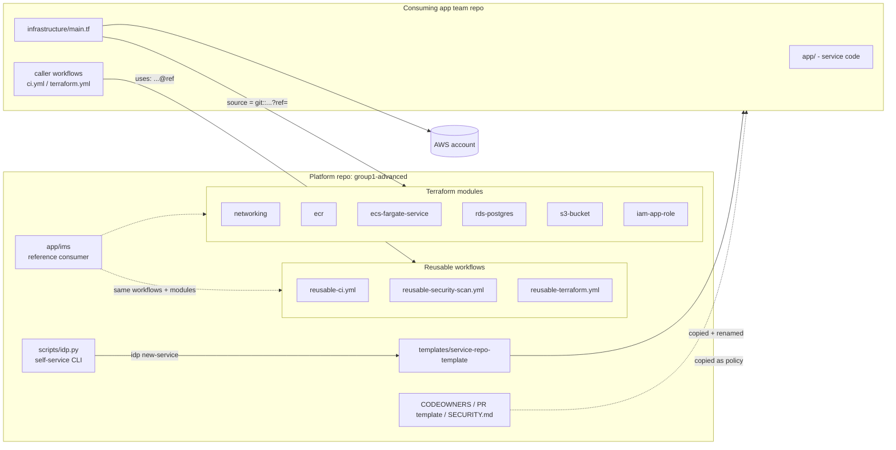
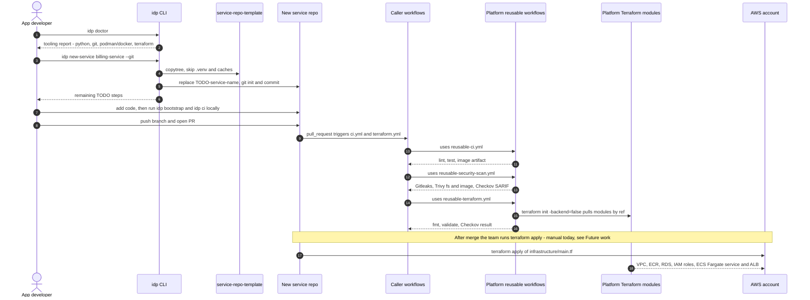
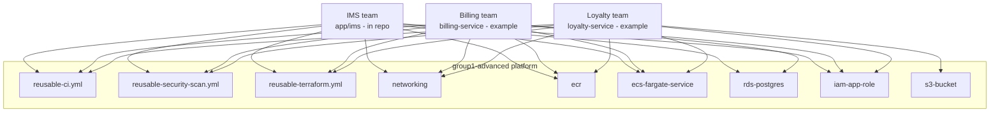

# Platform Architecture: Acme Retail Internal Developer Platform

## 1. Purpose

Acme Retail Ltd. first shipped the **Inventory Management System (IMS)** as a one-off: its own Dockerfile, its own
CI job, its own hand-built cloud setup. Each new service would have meant repeating that work, and every team would
have done it a little differently. The Internal Developer Platform (IDP) in this repository (`group1-advanced`) pulls
out everything the IMS needed that was *not* IMS-specific and offers it as a reusable, versioned capability.

The IMS (`app/ims`) stays in the repo as the **reference consumer**. It uses the same reusable workflows and
Terraform modules that any other team would, so it doubles as the platform's integration test.

## 2. Platform components

| Asset | Location | What it gives consuming teams |
|---|---|---|
| Reusable CI workflow | `.github/workflows/reusable-ci.yml` | Python setup, `ruff` lint, `pytest`, Buildx image build, image passed on as a workflow artifact |
| Reusable security workflow | `.github/workflows/reusable-security-scan.yml` | Gitleaks, Trivy filesystem, Trivy image, Checkov (optional), with SARIF reports |
| Reusable Terraform workflow | `.github/workflows/reusable-terraform.yml` | `terraform fmt -check`, `init -backend=false`, `validate`, Checkov |
| Terraform modules | `infrastructure/modules/{networking,ecr,ecs-fargate-service,rds-postgres,s3-bucket,iam-app-role}` | Pre-hardened AWS building blocks |
| Reference environment | `infrastructure/environments/dev` | A worked example that wires the modules together for the IMS |
| Service repo template | `templates/service-repo-template` | Flask skeleton, Dockerfile, caller workflows, `infrastructure/main.tf` that consumes the modules, AI spec stubs |
| Self-service CLI | `scripts/idp.py` (wrappers `scripts/idp.ps1`, `scripts/idp`) | `doctor`, `list-services`, `new-service`, `bootstrap`, `lint`, `test`, `build`, `up`/`down`/`status`, `scan`, `tf-validate`, `ci` |
| Governance | `.github/CODEOWNERS`, `.github/PULL_REQUEST_TEMPLATE.md`, `SECURITY.md` | Ownership, review routing, PR checklist, vulnerability reporting |
| Design records | `docs/ai-specifications/`, `docs/engineering-decisions/ADR-000*.md` | Why the platform looks the way it does |

### Design principles

- **Golden path, not golden cage.** The template and modules are the default way to ship. Everything is exposed as
  inputs (`app_dir`, `image_name`, `terraform_dir`, module variables), so teams configure instead of forking.
- **Consume by reference, never by copy.** Workflows are called with `uses: <org>/group1-advanced/...@ref`, and
  modules are sourced with `git::...//infrastructure/modules/<name>?ref=modules/v1.0.0`. A fix made once in the
  platform reaches every consumer when they bump the ref.
- **Local parity.** Every CI stage has an `idp` command that runs the same tool locally (see
  [cicd-pipeline.md](cicd-pipeline.md#5-local-parity)).
- **Secure by default.** Modules ship hardened (encryption, private subnets, least-privilege IAM, locked-down
  default SG). Every deliberate exception carries an inline `checkov:skip` with its reason.

## 3. Onboarding a new team

`idp new-service <name>` checks the name is lowercase kebab-case, copies `templates/service-repo-template` to a
sibling directory (or `--output`), replaces the `TODO-service-name` placeholder in every text file, and can run
`git init` with a first commit (`--git`). It then lists the manual `TODO(new-service)` / `TODO(platform-owner)`
items: drop in real code, set the platform repo path/ref, and fill in the AI specs.

## 4. Multi-team reuse

Several teams can share one set of modules and workflows and still keep separate state, AWS resources and names.
Isolation comes from `local.name = "${var.environment_name}-${var.app_name}"`, which prefixes every resource
(`dev-ims-alb`, `dev-billing-cluster`, `prod-loyalty-db-credentials`, ...).

The teams below are examples. Only `ims` exists in this repo today.

| Concern | Shared, owned by platform | Per team |
|---|---|---|
| CI logic and security gates | Reusable workflows | Inputs: `app_dir`, `image_name`, `terraform_dir` |
| AWS building blocks | Modules | Module inputs, Terraform state, AWS resources |
| Ownership and review | CODEOWNERS pattern, PR template | Team handle in their own CODEOWNERS |
| Local tooling | `idp` CLI | `--app` argument |

## 5. Versioning strategy

The platform is consumed by reference, so changing a ref on `main` affects every consumer at once. The intended
model uses **two independent tag series**, because workflows and modules change at different speeds:

| Artifact | Tag series | How consumers pin | State today |
|---|---|---|---|
| Reusable workflows | `workflows/vMAJOR.MINOR.PATCH` | `uses: <org>/group1-advanced/.github/workflows/reusable-ci.yml@workflows/v1.0.0` | Template uses `@main`, with a `TODO(platform-owner)` to pin a tag |
| Terraform modules | `modules/vMAJOR.MINOR.PATCH` | `source = "git::https://github.com/<org>/group1-advanced.git//infrastructure/modules/ecr?ref=modules/v1.0.0"` | Template already pins `modules/v1.0.0`; the tag still has to be cut |
| Inside the platform repo | n/a | IMS and `environments/dev` use local paths (`./.github/workflows/...`, `../../modules/...`) | So the platform always tests its own HEAD |

Semantic versioning rules:

- **PATCH**: bug fixes or tighter scanner pins, with no input or output changes.
- **MINOR**: new optional inputs or variables with safe defaults (for example `certificate_arn`, `access_logs_bucket_id`).
- **MAJOR**: renamed or removed inputs/outputs, or resource address changes that force replacement. Ship with
  upgrade notes in an ADR.

Provider constraints (`aws ~> 5.0`, `random ~> 3.6`, `required_version >= 1.5.0`) live in each module. CI runs
Terraform `1.9.5`.

## 6. Future work

These are not implemented yet:

- Cut the first `workflows/v1.0.0` and `modules/v1.0.0` tags and update the template callers.
- A deploy workflow (ECR push with OIDC role assumption, `terraform plan`/`apply` against a remote S3 state
  backend, ECS service update). Today the Terraform workflow only validates, with `-backend=false`.
- A software catalog or portal on top of `idp list-services`.
