# Security Architecture (DevSecOps)

Security is built into the platform at every stage a change passes through, from the developer's laptop to the
running task. The aim is to catch each class of problem at the earliest, cheapest layer, then check again further
down so that a miss in one layer is caught by another. Because the controls live in reusable workflows, modules
and the template, every service built on the platform gets them automatically.

## 1. Shift-left layers

```mermaid
flowchart LR
    subgraph L1["1 - Developer machine"]
        D1["idp lint / idp test"]
        D2["idp scan<br/>Gitleaks, Trivy fs, Checkov"]
        D3["idp tf-validate"]
        D4[".gitignore and .env.example<br/>no real secrets in repo"]
    end
    subgraph L2["2 - Pull request"]
        P1["PULL_REQUEST_TEMPLATE.md<br/>checklist"]
        P2["CODEOWNERS<br/>platform-team / ims-team review"]
    end
    subgraph L3["3 - CI"]
        C1["ruff + pytest"]
        C2["Gitleaks full history"]
        C3["Trivy fs CRITICAL,HIGH"]
        C4["permissions: contents read<br/>no cloud creds"]
    end
    subgraph L4["4 - Image"]
        I1["Trivy image gate"]
        I2["alpine, multi-stage, pip removed,<br/>non-root appuser"]
        I3["ECR scan_on_push"]
    end
    subgraph L5["5 - Infrastructure"]
        F1["terraform validate + Checkov"]
        F2["hardened modules<br/>encryption, private subnets, least-priv IAM"]
    end
    subgraph L6["6 - Runtime"]
        R1["SG chain ALB to task to DB"]
        R2["Secrets Manager injection"]
        R3["X-API-Key on product writes"]
        R4["CloudWatch logs, VPC flow logs,<br/>RDS logs"]
    end
    L1 --> L2 --> L3 --> L4 --> L5 --> L6
```

## 2. Controls by threat

Only controls that exist in the repo are listed here. Planned ones are in section 4.

| Threat | Control | Tool / mechanism | Where enforced |
|---|---|---|---|
| Credentials committed to git | Secret scanning of the full history | Gitleaks (`gitleaks/gitleaks-action@v2`, `fetch-depth: 0`) | `reusable-security-scan.yml` `secrets-scan`; locally `idp scan` |
| Vulnerable Python dependencies | CRITICAL/HIGH CVE gate | Trivy fs (`trivy-action@v0.36.0`) | `dependency-scan` job; `idp scan` |
| Vulnerable OS or base-image packages | CRITICAL/HIGH CVE gate on the built image; registry rescan | Trivy image; ECR `scan_on_push` | `image-scan` job; `ecr` module |
| Container breakout / privilege escalation | Non-root UID 1001 `appuser`, `nologin` shell, no pip in runtime, minimal alpine, `apk upgrade` | Dockerfile | `app/ims/Dockerfile`, template `app/Dockerfile` |
| Insecure infrastructure config | Static IaC analysis, `soft_fail: false`; every exception is an inline `checkov:skip` with a reason | Checkov | `reusable-terraform.yml`; `terraform-scan` when `terraform_dir` set; `idp scan` |
| Broken or unformatted Terraform | fmt and validate gates | Terraform 1.9.5 | `reusable-terraform.yml`; `idp tf-validate` |
| Unreviewed changes to platform surfaces | Mandatory owner review | `.github/CODEOWNERS` (`/infrastructure/`, `/.github/workflows/`, `/templates/`, `/scripts/`, docs to `@platform-team`; `/app/ims/` to `@ims-team`) | GitHub PR review, once branch protection requires code owners |
| Incomplete PRs (no tests, no security consideration) | Author checklist | `.github/PULL_REQUEST_TEMPLATE.md` | Every PR |
| Undisclosed vulnerabilities | Private reporting process, documented gates | `SECURITY.md` | Repo policy |
| CI token abuse / supply chain via workflow | Least-privilege `GITHUB_TOKEN` (`contents: read`), no cloud credentials, versioned actions | Workflow `permissions` | All workflows |
| Database credential exposure | Generated 24-character password, stored only in Secrets Manager, injected by ECS through the execution role scoped to that one secret ARN | `random_password`, `aws_secretsmanager_secret`, `iam-app-role` | `rds-postgres`, `iam-app-role`, `ecs-fargate-service` modules |
| Direct network access to app or DB | Tasks and RDS in private subnets, no public IP, `publicly_accessible = false`; SG chain ALB to service on 3000 to DB on 5432; default SG has no rules | Security groups, subnets | `networking`, `ecs-fargate-service`, `rds-postgres`, root `db_from_ims_service` |
| Data at rest disclosure | RDS `storage_encrypted`, ECR KMS, S3 SSE-KMS + public access block | AWS encryption | Modules |
| Data in transit to DB | `rds.force_ssl = 1` | RDS parameter group | `rds-postgres` |
| HTTP request smuggling / malformed headers | `drop_invalid_header_fields = true`; TLS 1.2+ policy when HTTPS is enabled | ALB | `ecs-fargate-service` |
| Unauthorised catalogue changes | `X-API-Key` required on POST/PUT/PATCH/DELETE `/products` | `require_api_key` decorator | `app/ims/app/routes.py` |
| Malformed or abusive input | Schema validation (lengths, ranges), sort-column allow-list (`SORTABLE`), `per_page` capped at 100, parameterised ORM queries | marshmallow, SQLAlchemy | `schemas.py`, `routes.py` |
| Information leak in errors | Uniform JSON error body from `HTTPException` handler | Flask | `app/__init__.py` |
| Undetected incidents | App logs to CloudWatch (400 days), VPC flow logs (ALL), RDS `postgresql`/`upgrade` log exports, `log_statement=ddl`, Container Insights, Performance Insights | CloudWatch | `ecs-fargate-service`, `networking`, `rds-postgres` |

## 3. Accepted risks (documented exceptions)

These are deliberate, recorded as inline `checkov:skip` reasons, and acceptable for a dev environment:

- HTTP-only ALB until a certificate exists (`CKV_AWS_2`, `CKV_AWS_103`, `CKV2_AWS_20`, `CKV_AWS_260`).
- No WAF (`CKV2_AWS_28`).
- Access logs opt-in (`CKV_AWS_91`, S3 `CKV_AWS_18`).
- AWS-managed keys instead of CMKs (`CKV_AWS_149`, `CKV_AWS_158`, `CKV_AWS_354`).
- No secret rotation (`CKV2_AWS_57`).
- Password auth rather than IAM DB auth (`CKV_AWS_161`).
- Unrestricted egress on SGs (`CKV_AWS_382`).
- Deletion protection and Multi-AZ off (`CKV_AWS_150`, `CKV_AWS_293`, `CKV_AWS_157`).
- Public subnets map public IPs, for the ALB only (`CKV_AWS_130`).

## 4. Gaps and future controls

These are not implemented:

- **`API_KEY` on ECS.** DB credentials are injected key by key from Secrets Manager into `PG*`, but `API_KEY` is
  not provided yet, so `demo-key` would be live. See [aws-deployment-architecture.md](aws-deployment-architecture.md#secrets-path).
  The fix is to store it in Secrets Manager and add it to `secrets`.
- **SARIF upload to GitHub code scanning.** Reports are workflow artifacts only. Uploading needs `security-events: write`.
- **Action pinning by commit SHA,** and pinning the local scanner images (`:latest` today) to the same versions CI uses.
- **SBOM and image signing,** for example Syft and cosign, plus an admission or verification step.
- **Real authentication and authorisation.** Per-user identity in place of a shared API key; the cart and checkout
  endpoints are unauthenticated.
- **Read-only root filesystem** and dropped capabilities in the ECS task definition.
- **Branch protection settings** that make the CI checks and code-owner review required. These are GitHub repo
  settings, not files, and need configuring once the repo is hosted. The CODEOWNERS handles are placeholders
  (`TODO(platform-owner)`).
